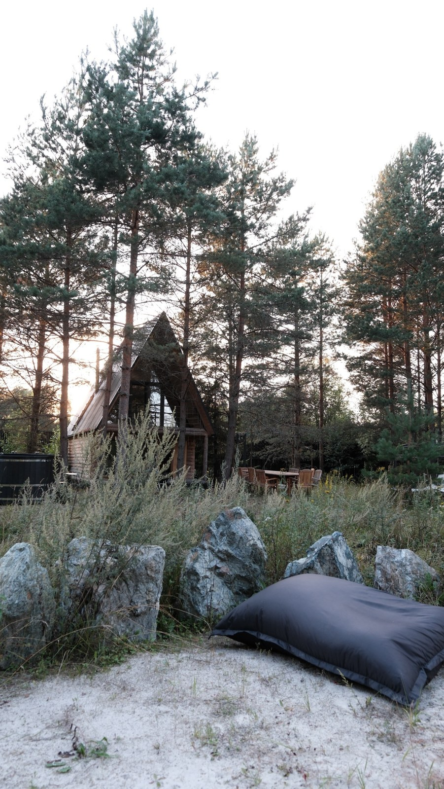
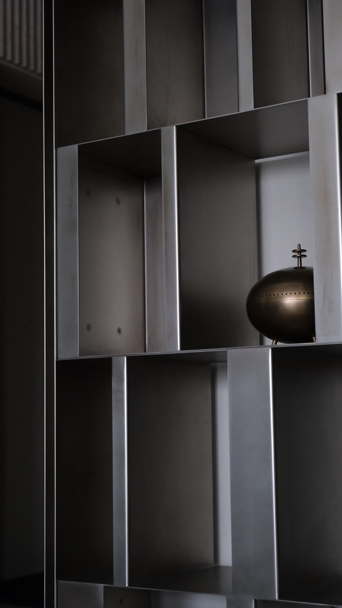
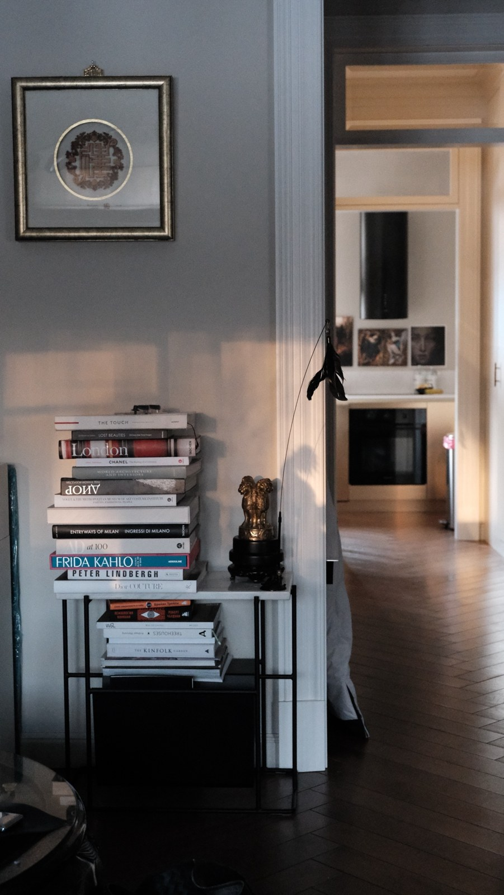
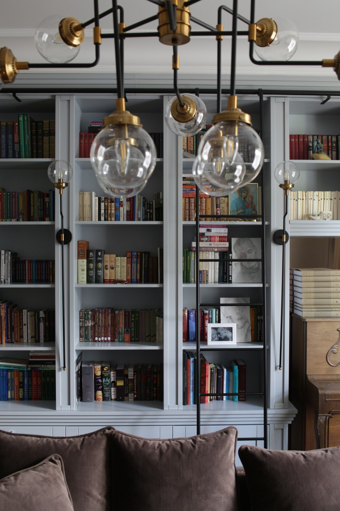
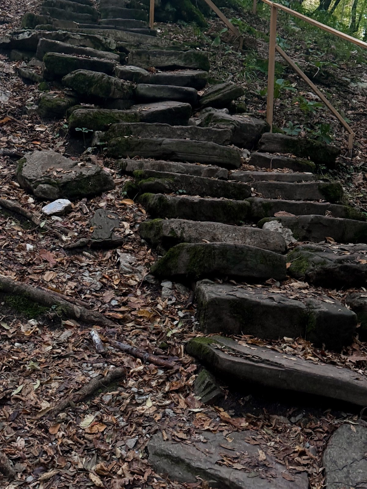
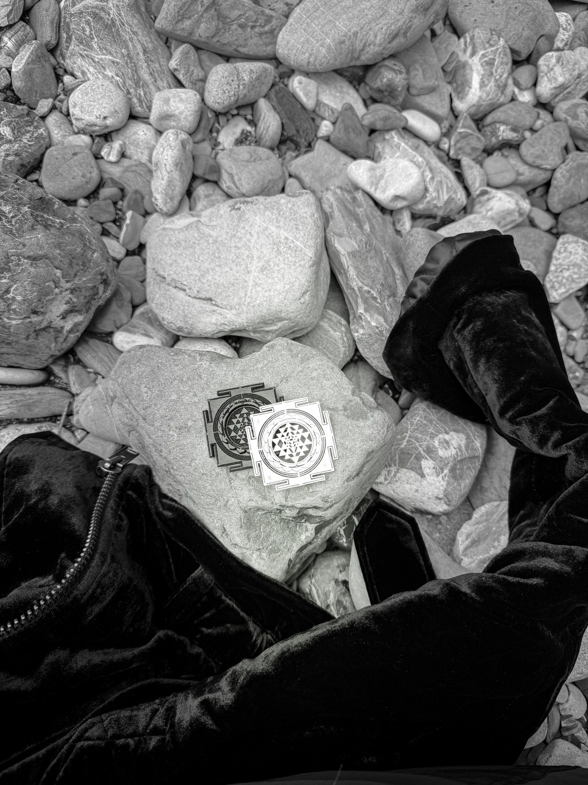
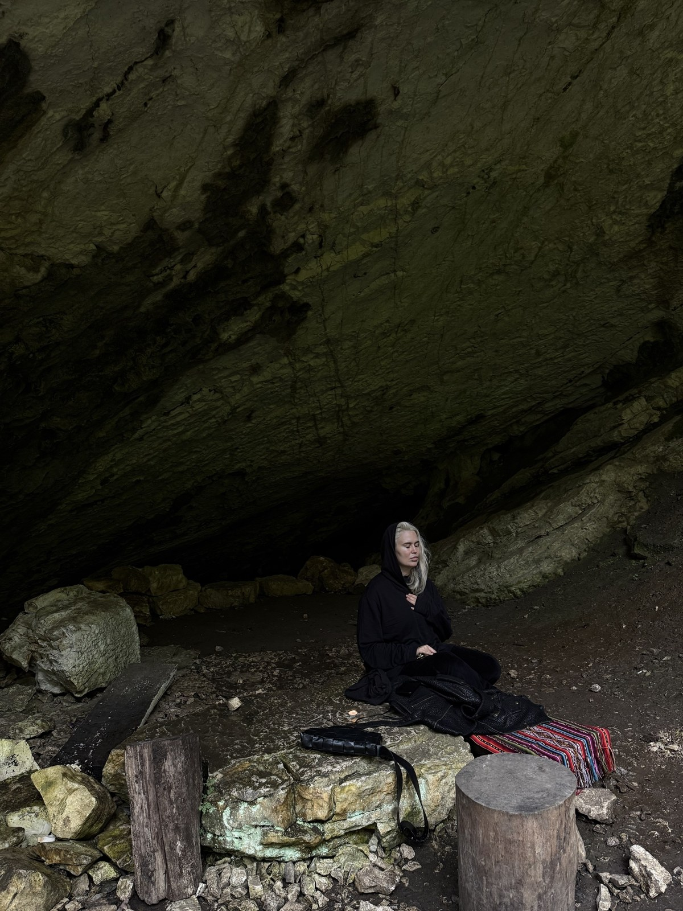

# Дом — это ваша любовь к себе

*А стройка — путь, на котором эта любовь заново прокладывает себе дорогу.*

Через свою профессию я делаю одну простую вещь: забочусь о людях. Не о квадратных метрах, не о мраморе и латуни — о людях. Просто мой язык заботы — пространство.

## Не о комоде

Со стороны мои встречи с клиентами выглядят очень земными. Мы обсуждаем комод в спальне. Цвет стены, на которую падает утренний свет. Какое настроение хочется чувствовать, когда открываешь дверь вечером. Какой ширины подоконник, на котором вы будете сидеть с книгой.

Кажется, что это разговор о вещах. Но за ним стоит мой любимый процесс — тот, ради которого я до сих пор выбираю эту профессию. **В этих разговорах происходит тихое исцеление через пространство.**

Человек, который выбирает комод, на самом деле отвечает на вопрос: как я хочу, чтобы обо мне заботились? Какой свет мне нужен утром, чтобы день начался мягко? Что я готов хранить на виду, а что — только для себя? Каждое такое решение — маленький выбор в пользу себя.

Я работаю медленно. Вдумчиво. Не потому что не умею быстро, а потому что иначе нельзя. Я видела десятки домов, рождённых таким образом, — не сотни, и я этим горжусь. Каждый из них я пропустила через душу и через долгий, плотный, честный диалог с людьми, которые в нём будут жить.

> Кажется, что мы выбираем комод. На самом деле человек отвечает на вопрос: как я хочу, чтобы обо мне заботились?

## Дом — это храм

Я искренне верю, что дом — это храм. Не в декоративном смысле, а в самом прямом: это место, которое защищает.

В доме-храме вам всегда безопасно. Спокойно. Предсказуемо — в лучшем смысле этого слова. Вы знаете, где лежит каждая вещь, как падает свет в шесть вечера, как звучит тишина в спальне. Здесь стабильная, красивая энергетическая решётка, которая отсекает всё, что вы невольно принесли через порог из внешнего мира: спешку, чужие ожидания, тревогу, усталость от тысячи решений за день.

Порог — это граница. И хороший дом умеет её держать.

## «Давайте построим дом»

Эта фраза звучит как начало проекта. На самом деле это начало большого путешествия внутрь себя — и почти никто не знает об этом заранее.

Длительная стройка поднимает на поверхность то, что лежало десятилетиями. Я видела, как в процессе выбора кухни вскрывается скупость между супругами, о которой они не говорили годами. Как вопрос «а где будет твой кабинет?» оказывается вопросом о том, сколько места каждый занимает в жизни другого. Как обсуждение гардеробной касается очень интимных, бережных сторон отношений, которые никто раньше не проговаривал вслух.

А дальше — вопросы, которые затрагивают всю жизнь. Как мы будем делить бюджет? Пространство? Будем ли мы проектировать детские для детей, которых пока даже не планировали? Это наше родовое гнездо? Будем ли мы жить с родителями — или построим им отдельный дом?

Таких вопросов — миллион. И каждый — не про планировку. **Каждый — про то, как вы любите себя и тех, кто рядом.**

## Восстановление связей

Мы привыкли думать о стройке как о процессе, который создаёт стены. Я думаю о ней как о процессе, который восстанавливает связи.

Связи внутри человека — между тем, чего он хочет, и тем, что он себе разрешает. Связи между супругами — когда впервые за много лет приходится честно договориться. Связи с родом — когда решаешь, каким будет дом для тех, кто придёт после тебя.

Каждое решение, принятое в пользу себя, — как новая тропинка. Сначала её едва видно. Но чем чаще по ней идёшь, тем она шире. **К концу стройки у человека появляется новая привычка: заботиться о себе.** И именно она остаётся с ним навсегда — дольше, чем любой ремонт.

## Две мои части

Дом для меня строится из технологии, которую очень грубо можно разделить на две части.

Первая — моя архитектурная и инженерная личность. Пропорции, узлы, конструкции, свет, материалы. То, без чего красота просто не выдержит реальную жизнь.

Вторая — управление. Уже больше десяти лет я лично веду сложные вопросы: финансы, бизнес-процессы, серьёзные кейсы, которые показываю только на встрече с клиентом, потому что они всегда конфиденциальны.

Когда человек видит, что я глубоко внутри индустрии, между нами появляется то, ради чего всё и работает: доверие. Он понимает, что я для него друг, а не тот, кто хочет взять больше, чем дать.

## Голодные волки

В любой премиальной индустрии много голодных волков, которые охотятся за чужим благополучием. Это правда, и об этом стоит говорить вслух.

Я делаю эту работу не потому, что должна. А потому, что не могу не создавать. Мне всегда нужны новые сложные задачи и люди, с которыми можно создать то, чего ещё не было. **Мне интересна сама задача — и человек, для которого я её решаю.**

## Никогда больше — до следующего раза

Тот, кто хоть раз строил, знает: это не просто строительство. Это сложный, объёмный, очень ёмкий психологический процесс. Стройка — великий модератор. Она распаковывает в вас такое, о чём вы даже не догадывались, пока не начали.

Меняются подрядчики. Одни не выдерживают и уходят, другие раскрываются так, как никто не ожидал. И часто, завершая этот путь, люди крестятся и говорят: «Больше никогда в жизни». А потом проходит пару лет, энергия накапливается — и они снова хотят в игру.

Потому что где-то глубоко они знают: это была не мука. Это был рост.

## Держать поле

> Архитектор — это шаман, который держит поле.

Это возможно, только когда мы договорились об условиях игры. Когда люди действительно хотят играть. С большим уважением к личному пространству каждого. С пониманием, что свято, а что — нет.

Любая такая игра — наш общий психический ресурс, объединённое поле подсознания. И мы играем в нём по правилам высшего поля: **созидания, уважения, любви и красоты.** Но основа всему — любовь.

## Спуститься в ад

Этот мир устроен так: если твоя великая цель — создать красоту, ты должен не бояться спуститься в ад.

Стройка обязательно проведёт вас через сложные моменты: споры, перерасчёты, сомнения, усталость. Но когда это изначально держится в поле игры — когда все понимают, что у игры есть правила, — играть становится легче. И даже веселее.

---

Когда стройка заканчивается, люди получают ключи. Но настоящий результат не в ключах. Он в том, что за эти месяцы человек научился честно говорить о том, чего хочет. Договариваться с близкими. Разрешать себе красоту, тишину, свой угол, свой свет.

Я строю не стены. **Я помогаю людям построить место, где они любят себя.**

> А ваш дом — это любовь к себе? Или пока только адрес?

Если вы чувствуете, что пора построить дом, который будет вас любить, — напишите мне. Дом, пентхаус, квартира: я веду проект от первого разговора до последнего гвоздя.

*Анастасия Резникова · ANRE ARCHITECTS · ANRE DESIGN*
