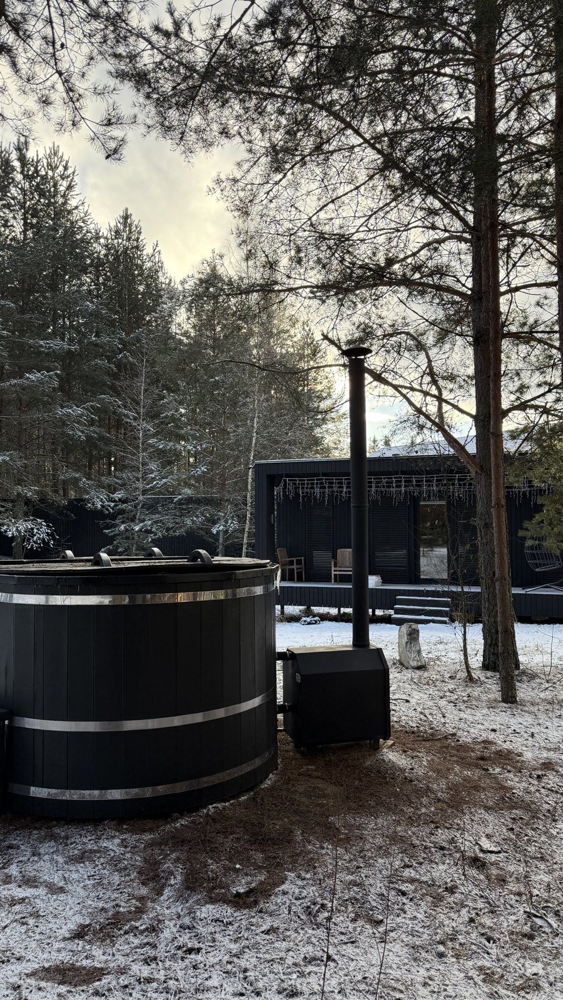
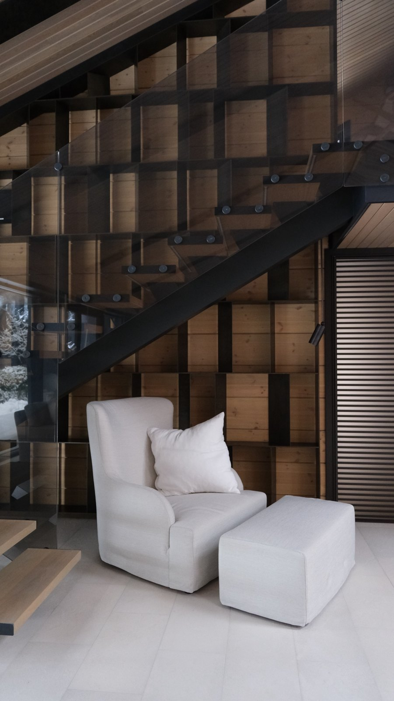
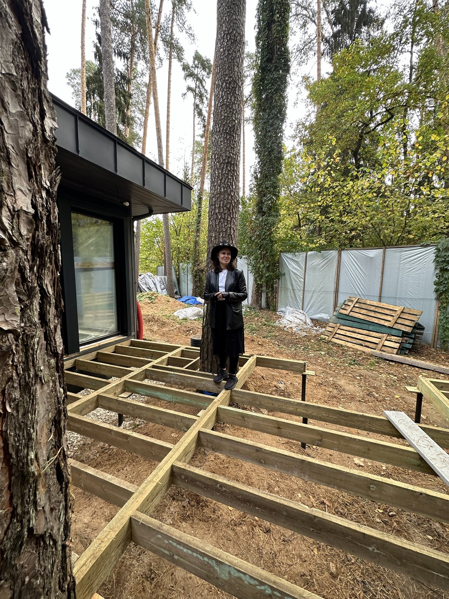
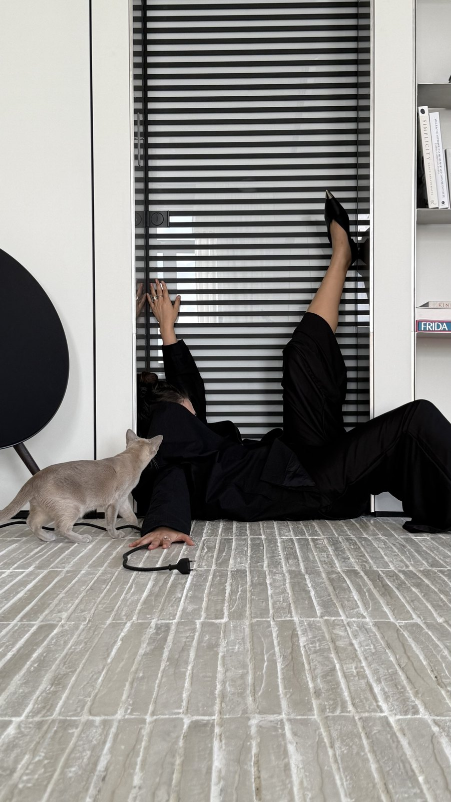
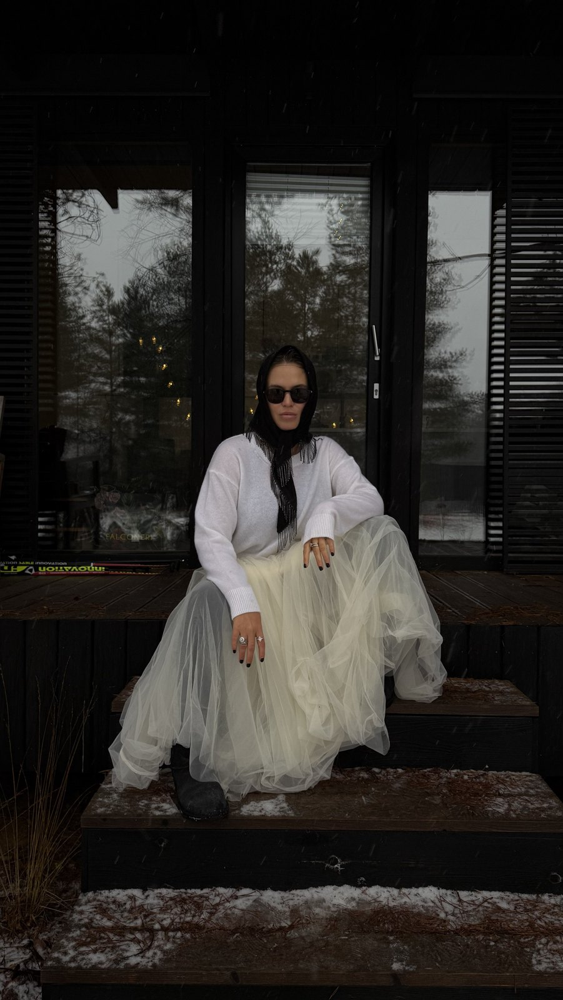
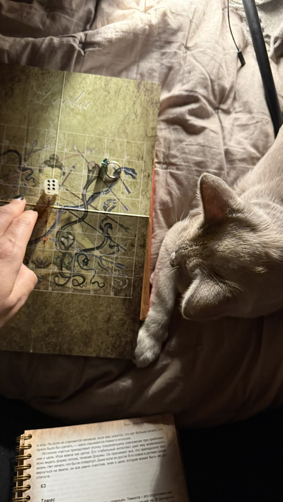
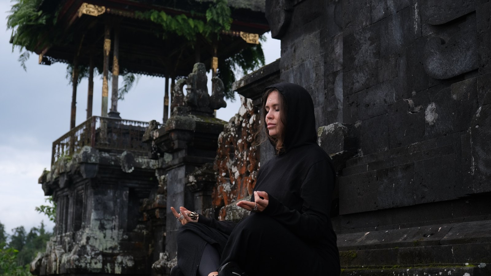
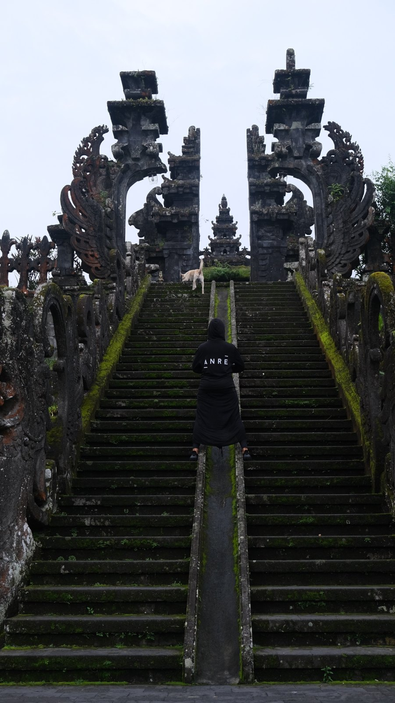
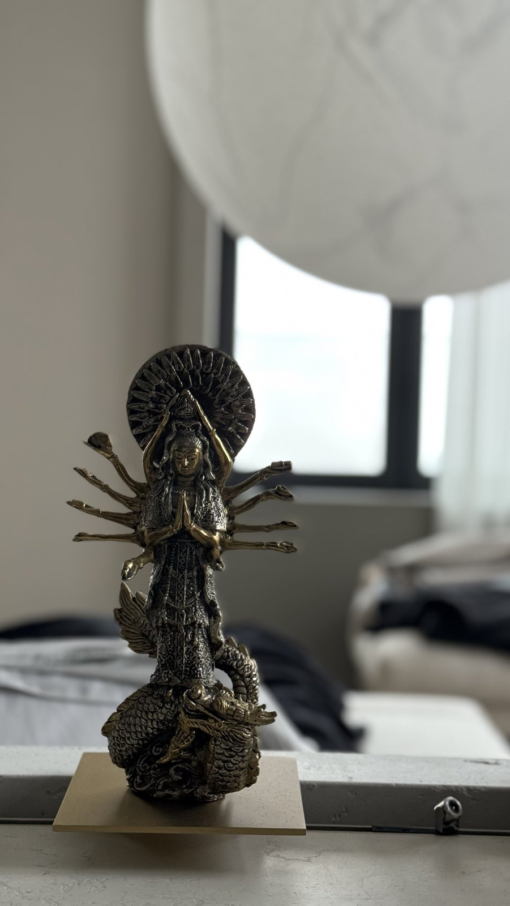

# Дом — это личность

*Почему я смотрю на дом как на живую сущность — и что это меняет для того, кто в нём живёт.*

Когда люди говорят о доме, они чаще всего говорят о квадратных метрах, планировке, смете и сроках. Это важный разговор, и я веду его всю свою профессиональную жизнь. Но для меня дом начинается с другого. **Я смотрю на дом как на живую сущность.**

Моё мышление вообще очень вне рамок, и я ценю это в себе. Поэтому попробую объяснить, что я имею в виду, — не метафорой, а тем, как я на самом деле работаю.

## Что такое «живой»

Живое — это то, в чём есть душа. Но мы живём на земле, и здесь у любой души должно быть тело. Душа без тела не может проявиться; тело без души — просто форма.

**Дом для меня — это тело для души.** И когда я говорю «тело для души», я смотрю на проект как шаман, который рождает сущность. Сначала её нужно почувствовать, услышать характер. А потом обволочь этот мир в технологию: в пропорции, свет, материалы, конструкции и инженерные узлы.

> Шаманская часть и технологическая для меня не противоречат друг другу — одна без другой просто не работает.

## У дома есть характер

Что значит «дом — это личность»? У дома есть настроение. У него есть свои приколы. У него бывают хорошие дни и плохие. **У него есть живая жизнь.**

Дом может на вас обидеться. Может вас любить. Может вас защищать — и может вас не пускать. Хороший дом фильтрует: отсекает от вас негатив и деструктив, который приходит снаружи.

И в этих отношениях вы тоже играете роль. Вы можете быть его помощником, проводником, хранителем и владельцем. Это коммуникация не с вещью, а с сущностью.

> Хозяин дома — проводник его сущности. Вы живёте внутри неё и помещаете её в своё пространство земли.

## Дом, созданный из души

Я говорю не обо всех зданиях. Я говорю о поместьях, виллах, личных квартирах — о том, что создаётся из души для себя. Не «просто построить дом», а воплотить личные желания.

Создавая такой дом, человек начинает **соединять огромное количество систем в своём подсознании.**

В мире построены миллиарды пустых бездушных коробок. Они могут быть даже симпатичными. Но они никого не дёргают — **в них нет ни одной струны души.**

Я проповедую другой подход. Про жизнь, про любовь и про то, что всё живое. Для меня всё живое — тем более то, что создаётся с инвестицией очень долгого времени и внимания.

## Рождаем вместе

Такую сущность нельзя заказать как вещь. Её рождают вместе — архитектор и клиент. Именно поэтому я не раз говорила, что между мной и клиентом должен быть контакт.

Я искренне радуюсь, когда встречаю клиентов, которые свободны. **Свободны во всех возможных смыслах своего сознания.** Потому что именно так получается реально классный живой проект.

Контакт — это совсем не обязательно единое мировоззрение. У меня искреннее ощущение, что я могу найти общий язык с кем угодно. Самое главное — чтобы у человека была ко мне настоящая, истинная реакция: уважение, восхищение, интерес, интрига. Влечение — в правильном смысле слова, как к источнику энергии.

> Вы никогда не будете удовлетворены работой креатора, если вам не нравится сам источник.

## Живой архитектор

Так я смотрю на вещи, потому что я живой архитектор. Кто-то проектирует стены. Я помогаю родиться сущности, которая будет любить, защищать и держать своего человека много лет.

> А ваш дом — живая сущность? Или красивая коробка?

Если вы хотите дом, который будет живым, — напишите мне. Поместье, вилла, пентхаус, квартира: я веду проект от первого разговора до последнего гвоздя.

Или начнём с концепции: я консультирую по концептированию дома — помогаю услышать его характер, собрать идею и сценарий жизни до начала проекта.

*Анастасия Резникова · ANRE ARCHITECTS · ANRE DESIGN*
