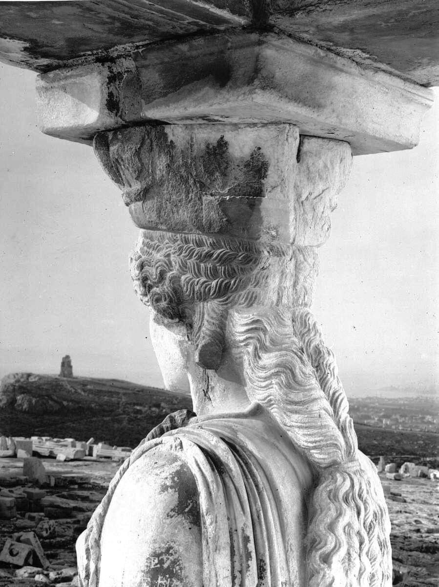
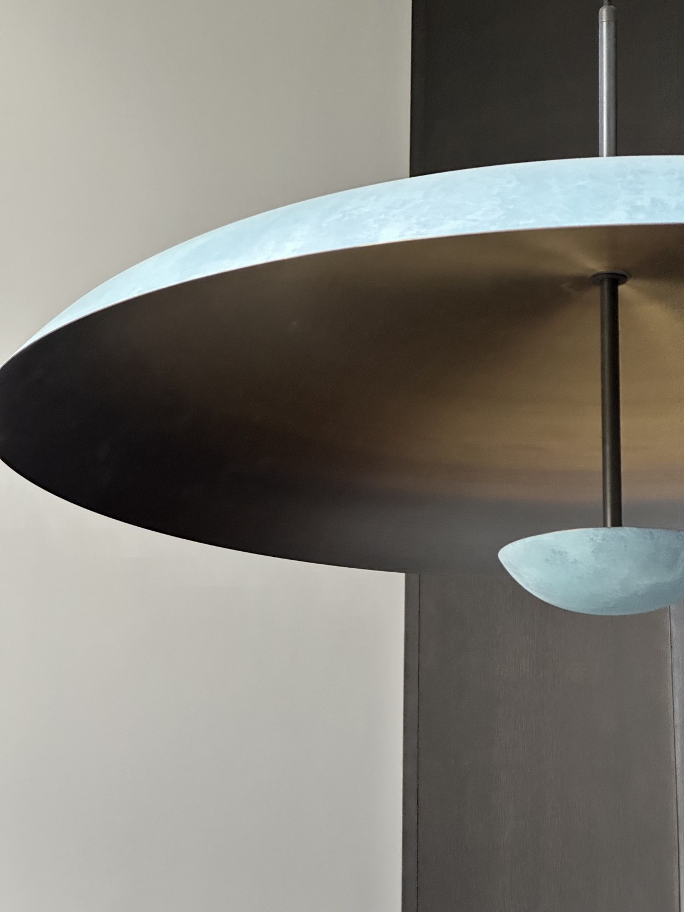
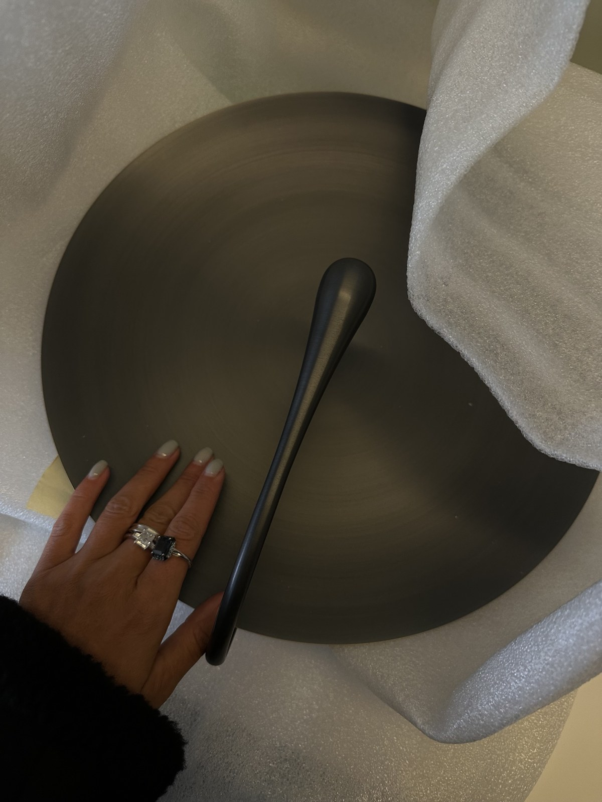
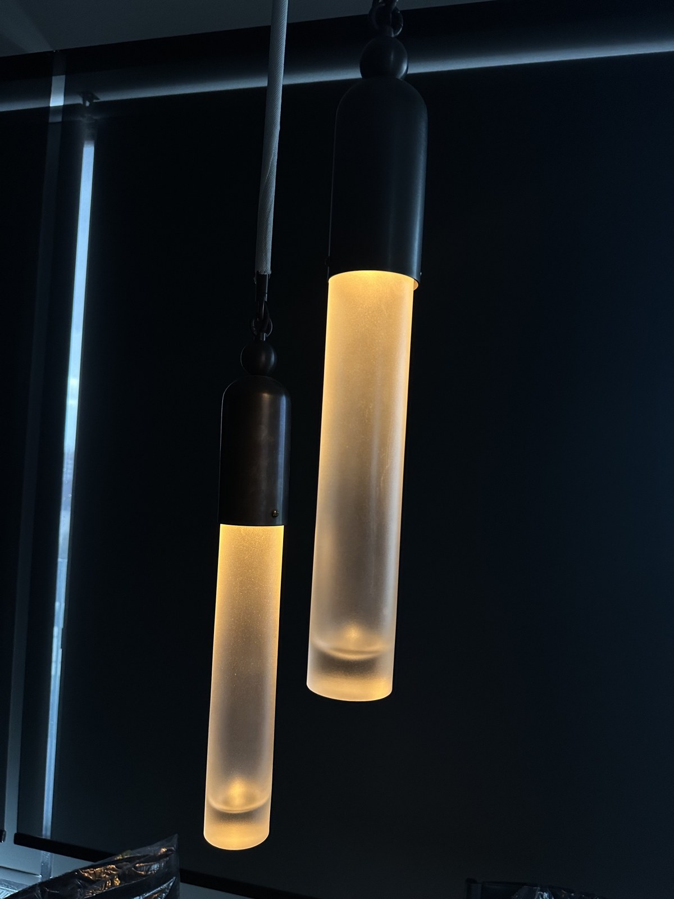
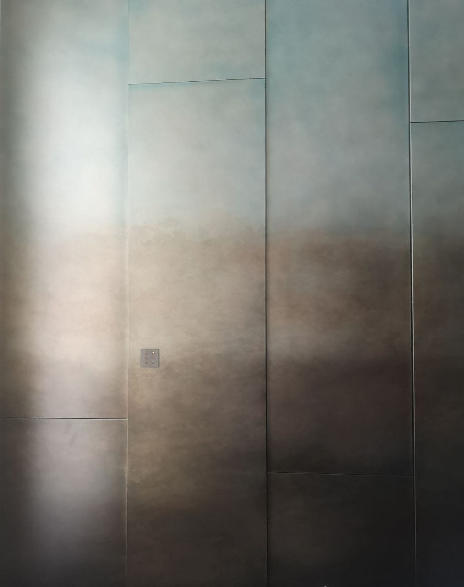

# Витрувий сегодня · I. Кариатиды

*Какую историю рассказывают детали — тогда и сегодня.*

Я начинаю новую серию. Две тысячи лет назад римский архитектор Витрувий написал «Десять книг об архитектуре» — единственный трактат античности, который дошёл до нас целиком. Я читаю его как древний текст и спрашиваю: что это значит сегодня, в моих домах, в вашей жизни?

## Архитектор должен знать историю

В первой книге Витрувий перечисляет, что должен знать архитектор. И среди первого — историю. Не для эрудиции, а чтобы объяснять смысл украшений. Каждый орнамент — это сообщение, и архитектор обязан знать, что именно он говорит.

И его главный пример — кариатиды.

## Застывшее наказание

Кариатиды — это женщины, пленённые и навечно застывшие в архитектуре. По Витрувию, город Карии в Пелопоннесе встал на сторону персов. После победы греки разрушили город и увели его женщин в плен. А архитекторы закрепили это в камне: женщины держат архитрав своей головой — как вечную муку и наказание за то, что их город предал.

Это яркий пример того, как государство разговаривало с людьми через архитектуру. Архитектура тогда была не только формой. Это была замороженная форма политической пропаганды. Хоть и очень красивая.

И здесь я задаю себе вопрос: а какую историю рассказывают детали моих проектов?

## Я за созидание

Лично я — за созидание, а не за наказание. Я верю, что мир форм и пропорции предметов разговаривают с нами на всех уровнях — даже когда мы этого не замечаем. Именно поэтому я придаю такое значение деталям. Я выбираю не только вещь — я выбираю, кто её делал и что именно за ней стоит.

## Живой металл

Есть английская студия светильников, которую я очень люблю, — Atelier 001. Крошечная мастерская. Я лично приезжала к ним в Ноттинг-Хилл и видела, как они относятся к своему делу.

Мастера, которые работают с металлом, превращают процесс не просто в мастерство — в настоящую алхимию. Патина, вердигри, бронза, которая выглядит так, будто ей сто лет. Они понимали мой тонкий язык: что я хочу увидеть и что такое живой металл.

То же самое я могу сказать про американскую студию Apparatus и про итальянскую фабрику De Castelli. Это кастомные мастерские. Они не работают на огромные объёмы.

## Восковые печати

А их упаковка — такого я не видела нигде. Каждый ящик: внутри всё упаковано, запечатано, поставлены пломбы с восковой печатью — как раньше на письмах.

В этот процесс вложено столько любви, точности и чёткости, что так можно делать, только когда любишь своё дело. Мастера, которые любят своё дело, словно наполняют вещь этой энергией. И вещь потом отдаёт её дому.

## Сначала — любовь

Я верю, что за каждым настоящим брендом стоит заряд любви — как поток, как канал. И только потом он разливается в маркетинговые инструменты, в отделы продаж, в премиальные салоны. Но когда зарождается что-то настоящее, это всегда живая любовь.

## Без тени несчастья

Я не собираю вещи, сделанные без радости. Моя теория предметов и форм такая: они должны вызывать в человеке чувство радости и достоинства в собственных глазах. У меня не должно быть никакой ассоциации с тем, что кому-то от этого было плохо.

Это касается и людей рядом со мной. Мне важно, чтобы в моих проектах работали те, кто сам выбрал это дело и движется к нашей общей идее по собственной воле. Если человека нужно заставлять, значит, он просто ещё не готов к этому пути.

## Спокойное процветание

Кариатиды фиксировали наказание. Мои проекты — о фиксации победы и красоты. Не как противовес тому, что что-то было не так, а как естественная трансляция спокойного процветания, которое не нужно доказывать. В котором просто хорошо. Как будто так всегда и было — и так и будет.

А какую историю рассказывают вещи в вашем доме?

---

*Если вы строите виллу, дом или пентхаус и хотите, чтобы в нём жили вещи с историей, — напишите мне. Архитекторам и дизайнерам помогаю как консультант. Instagram @anre_architects · anredesign.com*
